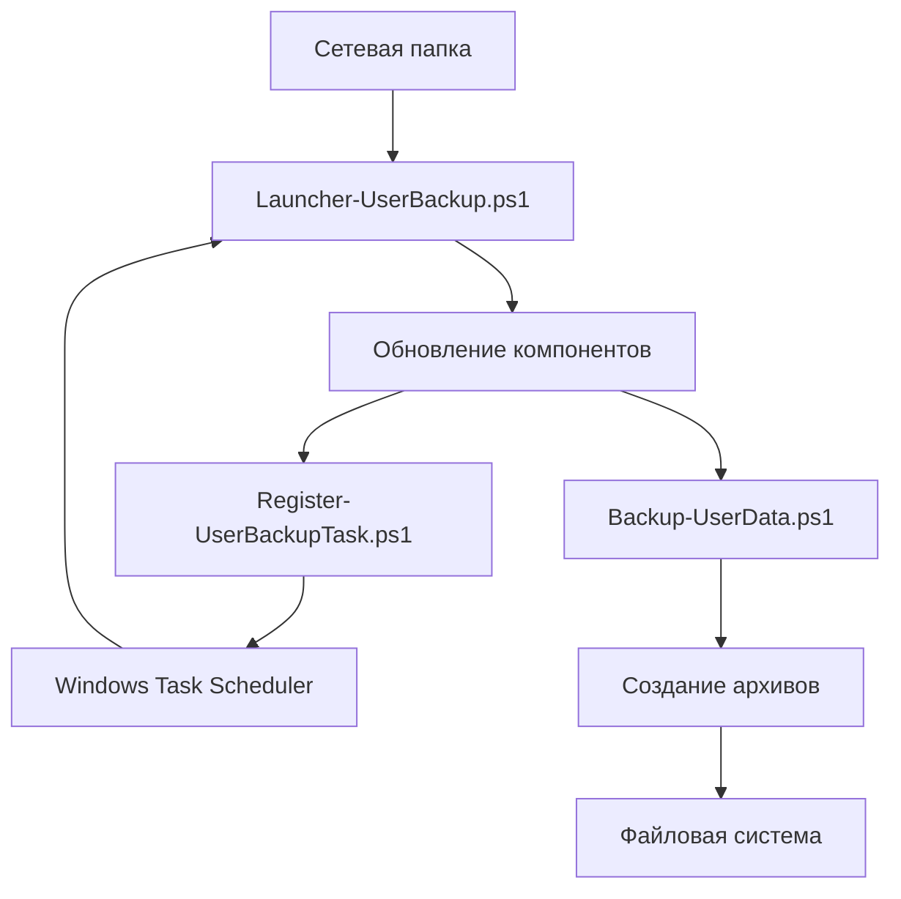

# Технические спецификации - User Backup Manager

## 🏗️ Техническая архитектура

### Обзор системы

User Backup Manager построен по архитектуре "централизованное управление - распределенное выполнение":

```
[Сетевая папка] ← Обновления → [Локальные клиенты] → [Архивы]
      ↑                                  ↓
[Администраторы]                 [Пользовательские данные]
```

### Компонентная модель



## 💻 Технические детали реализации

### Файловая структура

```
UserBackupManager/
├── 📂 .git/                          # Репозиторий Git
├── 📜 Backup-UserData.ps1            # Основной рабочий скрипт (2800+ строк)
├── 📜 BackupConfig.json              # Конфигурация JSON (UTF-8)
├── 📜 Install-UserBackup.cmd         # CMD обертка установщика
├── 📜 Install-UserBackup.ps1         # Скрипт установки (500+ строк)
├── 📜 Launcher-UserBackup.ps1        # Основной лаунчер (600+ строк)
├── 📜 LocalDirectoriesToBackup.lst   # Пользовательские директории
├── 📜 README.md                      Основная документация
├── 📜 Register-UserBackupTask.ps1    # Регистратор задач (1500+ строк)
├── 📜 Uninstall-UserBackup.cmd       # CMD обертка удаления
├── 📜 Uninstall-UserBackup.ps1       # Скрипт удаления (400+ строк)
├── 📜 QUICK_START.md                 # Краткое руководство
├── 📜 ADMIN_GUIDE.md                 # Руководство администратора
└── 📜 TECHNICAL_SPEC.md              # Технические спецификации
```

### Форматы данных

#### Конфигурация (BackupConfig.json)
```json
{
  "Install": { /* ... */ },
  "Task": { /* ... */ },
  "Update": { /* ... */ },
  "Backup": {
    "RootPath": "D:\\_BackUp_",          // Путь с экранированием
    "Sources": [                         // Массив объектов
      {
        "Name": "Desktop",               // Идентификатор
        "DisplayName": "Рабочий стол",   // Отображаемое имя
        "KnownFolder": "Desktop"         // Системная папка
      }
    ]
  }
}
```

**Кодировка**: UTF-8 без BOM  
**Валидация**: Проверка структуры и значений в `Assert-BackupConfig`

#### Локальные директории (LocalDirectoriesToBackup.lst)
```
:: Комментарий
True                    # Включен (True/False)

Pictures                # Относительный путь от %USERPROFILE%
Links                   # Еще один путь
Projects\Documentation  # Вложенный путь
```

**Кодировка**: UTF-8  
**Обработка**: Пропуск пустых строк и комментариев (`::`)

### Алгоритмы и логика

#### Процесс резервного копирования
```pseudocode
function BackupUserData(config):
    sources = GetSources(config)                     # Получение списка источников
    active_sources = FilterActiveSources(sources)    # Фильтрация активных
    
    if ShouldSkipBackup(active_sources):            # Проверка необходимости
        return SKIPPED
    
    for source in active_sources:
        size = CalculateSourceSize(source)           # Расчет размера
        if size > config.MaxSourceSizeMB:
            return SOURCE_TOO_LARGE
        
        free_space = GetFreeSpace(config.RootPath)   # Проверка места
        if free_space < size + config.SafetyReserveMB:
            return INSUFFICIENT_SPACE
        
        CreateBackupArchive(source)                  # Создание архива
        RotateOldArchives(source, config.CopiesToKeep) # Ротация
    
    return SUCCESS
```

#### Процесс обновления
```pseudocode
function UpdateFromNetwork(network_path, local_path):
    update_id = GenerateGuid()                       # ID обновления
    
    # Загрузка файлов
    files_to_update = [
        "BackupConfig.json",
        "Backup-UserData.ps1", 
        "Register-UserBackupTask.ps1",
        "Launcher-UserBackup.ps1"
    ]
    
    for file in files_to_update:
        temp_file = DownloadToTemp(network_path, file, update_id)
        ValidateFile(temp_file)                       # Валидация
        
        if not FilesEqual(temp_file, local_file):     # Сравнение хешей
            AddToUpdateQueue(temp_file, local_file)
    
    if update_queue.empty():
        return NO_CHANGES
    
    # Транзакционное обновление
    backup_state = CreateBackup(local_files)          # Бэкап текущих
    try:
        ApplyUpdates(update_queue)                    # Применение
        ValidateUpdatedSystem()                       # Валидация
        CommitUpdate(backup_state)                    # Фиксация
    catch error:
        RollbackUpdate(backup_state)                  # Откат
        throw error
    
    return SUCCESS
```

## 🔧 Технические требования

### Системные требования

| Компонент | Минимальные требования | Рекомендуемые требования |
|-----------|---------------------|------------------------|
| **ОС** | Windows 7 SP1 / Server 2008 R2 | Windows 10 1809+ / Server 2016+ |
| **PowerShell** | 5.1 | 7.2+ (с обратной совместимостью) |
| **.NET Framework** | 4.5 | 4.8 |
| **Память** | 256 MB для PowerShell | 512 MB |
| **Дисковое пространство** | Размер данных × 2 | Размер данных × 2 + 20% резерв |

### Зависимости PowerShell

```powershell
# Неявные зависимости
Add-Type -AssemblyName System.Windows.Forms  # GUI сообщения
Add-Type -AssemblyName System.Drawing        # Формы
Import-Module ScheduledTasks                 # Планировщик заданий

# Встроенные модули
Microsoft.PowerShell.Archive                 # Работа с ZIP
Microsoft.PowerShell.Management              # Файловые операции
Microsoft.PowerShell.Utility                 # Утилиты
```

### Ограничения и лимиты

| Параметр | Ограничение | Примечание |
|----------|-------------|------------|
| **Размер источника** | `MaxSourceSizeMB` (по умолчанию 700) | Настраивается в конфигурации |
| **Количество копий** | 1-100 | `CopiesToKeep`, ограничение логики ротации |
| **Время выполнения** | `ExecutionTimeLimitHours` (по умолчанию 6) | Ограничение планировщика задач |
| **Глубина пути** | 260 символов (MAX_PATH) | Ограничение Windows |
| **Размер архива** | 4 GB (ZIP) | Ограничение формата ZIP |
| **Количество файлов** | Теоретически не ограничено | Практически ограничено памятью |

## 📊 Форматы журналов

### Launcher.log
```
2026-10-19 09:00:00.123 [INFO] Launcher started. Version=2026.09.15.1.
2026-10-19 09:00:05.456 [INFO] Update completed successfully from '\\FS-01\Scripts\UserBackupManager\'.
2026-10-19 09:00:10.789 [ERROR] Network path unavailable: \\FS-01\Scripts\UserBackupManager\
```

**Структура**:
- Дата и время с миллисекундами
- Уровень логирования: `[INFO]`, `[WARN]`, `[ERROR]`
- Сообщение

**Ротация**: По размеру (1 МБ) и количеству файлов (5)

### UserBackup.log
```
[2026-10-19 09:00:15] Starting backup for user: DOMAIN\username
[2026-10-19 09:00:20] Source: Desktop, size: 145.67 MB
[2026-10-19 09:02:30] Created: 20261019_090000_Desktop.zip (146.2 MB)
```

## 🔐 Механизмы безопасности

### Аутентификация и авторизация

```powershell
# Проверка владельца задачи
function Test-AccountSid($Identity, $ExpectedSid):
    try:
        resolved_sid = Resolve-AccountSid($Identity)
        return resolved_sid == $ExpectedSid
    catch:
        return false

# Разрешение SID из различных форматов
function Resolve-AccountSid($Identity):
    if $Identity is SID:
        return $Identity
    else if $Identity is NTAccount:
        return $Identity.Translate(SecurityIdentifier)
    else:
        throw "Unresolvable identity"
```

### Валидация входных данных

```powershell
# Пример валидации пути задачи
function Validate-TaskPath($Path):
    if not $Path.StartsWith('\'):
        throw "Task.Path must start with backslash"
    if not $Path.EndsWith('\'):
        throw "Task.Path must end with backslash"
    if $Path.Contains('..'):
        throw "Task.Path must not contain parent directory references"
```

### Транзакционность обновлений

```powershell
# Механизм транзакционного обновления
$update_transaction = @{
    OriginalFiles = @()
    TempFiles = @()
    RollbackFiles = @()
}

try {
    # Фаза 1: Подготовка
    foreach ($file in $files_to_update) {
        $backup = Backup-File $file
        $update_transaction.OriginalFiles += $backup
    }
    
    # Фаза 2: Применение
    foreach ($update in $updates) {
        Apply-Update $update
        $update_transaction.TempFiles += $update.TempPath
    }
    
    # Фаза 3: Валидация
    Validate-SystemAfterUpdate
    
    # Фаза 4: Фиксация
    Commit-Update $update_transaction
} catch {
    # Откат в случае ошибки
    Rollback-Update $update_transaction
    throw
}
```

## 🧪 Тестирование

### Структура тестов

```
tests/
├── unit/                          # Модульные тесты
│   ├── Backup-UserData.Tests.ps1
│   ├── Launcher.Tests.ps1
│   └── Register-Task.Tests.ps1
├── integration/                   # Интеграционные тесты
│   ├── Installation.Tests.ps1
│   └── Update.Tests.ps1
└── performance/                   # Тесты производительности
    ├── BackupPerformance.Tests.ps1
    └── MemoryUsage.Tests.ps1
```

### Пример модульного теста

```powershell
Describe "Validate-TaskPath" {
    It "Проверяет корректный путь" {
        $path = "\ASUP\User BackUp Manager\"
        { Validate-TaskPath $path } | Should -Not -Throw
    }
    
    It "Отклоняет путь без начального слэша" {
        $path = "ASUP\User BackUp Manager\"
        { Validate-TaskPath $path } | Should -Throw "must start with backslash"
    }
    
    It "Отклоняет путь без конечного слэша" {
        $path = "\ASUP\User BackUp Manager"
        { Validate-TaskPath $path } | Should -Throw "must end with backslash"
    }
}
```

### Тестовые сценарии

| Сценарий | Входные данные | Ожидаемый результат | Критерии успеха |
|----------|----------------|---------------------|----------------|
| **Установка** | Чистая система | Успешная установка | Файлы скопированы, задача создана |
| **Обновление** | Существующая установка | Обновление файлов | Новые версии применены, задача обновлена |
| **Резервное копирование** | Данные пользователя | Создание архивов | Архивы созданы, ротация выполнена |
| **Восстановление** | Существующий архив | Восстановление данных | Данные восстановлены корректно |
| **Ошибка сети** | Недоступная сетевая папка | Локальный fallback | Работа продолжена с локальными файлами |

## 🔄 API и интерфейсы

### Внутренние API

#### Функция `Read-BackupConfig`
```powershell
function Read-BackupConfig {
    param(
        [Parameter(Mandatory)]
        [string]$Path
    )
    
    # Чтение и парсинг JSON
    $utf8 = [System.Text.UTF8Encoding]::new($false, $true)
    $json = [System.IO.File]::ReadAllText($Path, $utf8)
    return $json | ConvertFrom-Json -ErrorAction Stop
}
```

**Вход**: Путь к файлу конфигурации  
**Выход**: Объект конфигурации  
**Исключения**: `FileNotFoundException`, `JsonException`

#### Функция `Register-TaskWithUserIdFallback`
```powershell
function Register-TaskWithUserIdFallback {
    param(
        [string]$UserIdToTry,
        [string]$AttemptDescription,
        [ref]$LastError
    )
    
    # Попытка регистрации с разными форматами UserId
    # Возвращает $true при успехе, $false при неудаче
}
```

### Внешние интерфейсы

#### Командная строка установки
```powershell
Install-UserBackup.ps1
    [-ConfigPath <String>]        # Путь к конфигурации
    [-Diagnostic]                 # Диагностический режим
    [-WhatIf]                     # Пробный запуск
    [-Confirm]                    # Подтверждение
```

#### Командная строка лаунчера
```powershell
Launcher-UserBackup.ps1
    [-ConfigPath <String>]        # Путь к конфигурации
```

## 📈 Производительность

### Метрики производительности

| Метрика | Целевое значение | Метод измерения |
|---------|------------------|-----------------|
| **Время установки** | < 30 секунд | `Measure-Command { .\Install-UserBackup.ps1 }` |
| **Время обновления** | < 10 секунд | Время загрузки и применения обновлений |
| **Время резервного копирования** | Зависит от объема данных | `Get-Process powershell | Select-Object TotalProcessorTime` |
| **Использование памяти** | < 100 МБ | `Get-Process powershell | Select-Object WorkingSet64` |
| **Использование ЦП** | < 25% в пике | Счетчики производительности |

### Оптимизации

1. **Кэширование путей**
   ```powershell
   # Кэширование часто используемых путей
   $script:CachedPaths = @{
       LocalAppData = [Environment]::GetFolderPath('LocalApplicationData')
       UserProfile = [Environment]::GetFolderPath('UserProfile')
   }
   ```

2. **Пакетные операции с файлами**
   ```powershell
   # Использование Get-ChildItem с фильтрами вместо Where-Object
   $files = Get-ChildItem -Path $source -Recurse -File |
            Where-Object { $_.Extension -in $excludedExtensions }
   ```

3. **Асинхронные операции** (где применимо)
   ```powershell
   # Параллельная обработка нескольких источников
   $jobs = foreach ($source in $sources) {
       Start-Job -ScriptBlock {
           param($source)
           Process-Source $source
       } -ArgumentList $source
   }
   
   $results = $jobs | Wait-Job | Receive-Job
   ```

## 🔧 Обслуживание и мониторинг

### Ключевые счетчики производительности

```powershell
# Мониторинг через PowerShell
$counters = @(
    "\Process(powershell)\% Processor Time",
    "\Process(powershell)\Working Set",
    "\LogicalDisk(D:)\% Free Space",
    "\Network Interface(*)\Bytes Total/sec"
)

Get-Counter -Counter $counters -SampleInterval 60 -MaxSamples 10
```

### Журналирование событий Windows

```powershell
# Запись в журнал событий Windows
function Write-EventLogEntry {
    param(
        [string]$Message,
        [ValidateSet('Information', 'Warning', 'Error')]
        [string]$EntryType = 'Information'
    )
    
    $source = "User Backup Manager"
    if (-not [System.Diagnostics.EventLog]::SourceExists($source)) {
        [System.Diagnostics.EventLog]::CreateEventSource($source, "Application")
    }
    
    Write-EventLog -LogName Application -Source $source `
        -EventId 1000 -EntryType $EntryType -Message $Message
}
```

## 🚀 Развертывание и CI/CD

### Конвейер сборки

```yaml
# .github/workflows/build.yml
name: Build and Test

on: [push, pull_request]

jobs:
  test:
    runs-on: windows-latest
    steps:
    - uses: actions/checkout@v2
    
    - name: Run PSScriptAnalyzer
      run: |
        Install-Module -Name PSScriptAnalyzer -Force
        Invoke-ScriptAnalyzer -Path . -Recurse
        
    - name: Run unit tests
      run: |
        Invoke-Pester -Path tests/unit -Output Detailed
```

### Версионирование

```
Версия: ГГГГ.ММ.ДД.П
Пример: 2026.09.15.1

ГГГГ - год
ММ   - месяц
ДД   - день
П    - патч (начинается с 1)
```

### Контроль качества кода

```powershell
# Скрипт проверки качества
$analysis = Invoke-ScriptAnalyzer -Path . -Recurse -Severity Error, Warning

if ($analysis.Count -gt 0) {
    Write-Host "Найдены проблемы:" -ForegroundColor Red
    $analysis | Format-Table -AutoSize
    exit 1
} else {
    Write-Host "Код соответствует стандартам" -ForegroundColor Green
}
```

## 📚 Справочные материалы

### Стандарты кодирования

1. **Именование**
   - Функции: `Verb-Noun` (PascalCase)
   - Переменные: `$camelCase` для локальных, `$script:PascalCase` для скриптовых
   - Константы: `$UPPER_CASE`

2. **Обработка ошибок**
   ```powershell
   try {
       # Основная логика
   } catch [System.IO.FileNotFoundException] {
       # Специфичная обработка
   } catch {
       # Общая обработка
       Write-Error $_.Exception.Message
       throw
   }
   ```

3. **Комментарии**
   - Функции: Описание, параметры, возвращаемое значение
   - Сложная логика: Пояснения алгоритмов
   - TODO/FIXME: Отметки для будущих улучшений

### Полезные ссылки

- [PowerShell Documentation](https://docs.microsoft.com/powershell/)
- [About Functions](https://docs.microsoft.com/powershell/module/microsoft.powershell.core/about/about_functions)
- [ScheduledTasks Module](https://docs.microsoft.com/powershell/module/scheduledtasks/)
- [PSScriptAnalyzer Rules](https://github.com/PowerShell/PSScriptAnalyzer#rules)

---

*Данный документ должен обновляться при изменении архитектуры или добавлении новых функций.*

*Версия спецификации: 2.0*
*Последнее обновление: 19 октября 2026 г.*